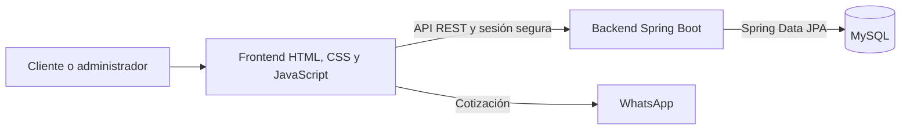

# SUBLI-INCA

**Plataforma web full-stack para catálogo y gestión de productos personalizados.** SUBLI-INCA reúne una tienda de catálogo, un carrito persistente y la cotización directa por WhatsApp con un panel administrativo protegido.

Este proyecto integra una interfaz web ligera con una API REST en Java y persistencia relacional. Está diseñado para mostrar productos personalizados, preparar pedidos y facilitar la administración del catálogo.

## Arquitectura y stack tecnológico

| Capa | Tecnologías |
| --- | --- |
| Frontend | HTML5, CSS3 y JavaScript Vanilla, organizado en archivos funcionales |
| Backend | Java 21, Spring Boot, Spring Web MVC, Spring Security y Spring Data JPA/Hibernate |
| Base de datos | MySQL 8 |
| Herramientas | Maven Wrapper, PowerShell y Live Server para desarrollo local |



## Características principales

- Catálogo público con productos destacados, búsqueda y filtros por categoría.
- Carrito que conserva productos y cantidades mediante `localStorage`.
- Preparación de cotizaciones con personalización y envío del detalle por WhatsApp.
- Panel administrativo para crear, consultar, editar, activar, desactivar y eliminar productos.
- Subida de imágenes con límite de 5 MB y validación de extensión, MIME declarado, firma binaria real y contenido decodificable cuando aplica. Los archivos se guardan con nombres UUID.
- Autenticación administrativa con Spring Security, sesión, protección CSRF y credenciales configuradas fuera del código mediante variables de entorno.
- Validación de productos en el backend: nombre obligatorio, precio no negativo y categoría permitida.
- Respuestas globales de error HTTP en JSON mediante `@RestControllerAdvice`.
- Escape de contenido dinámico antes de insertarlo en HTML para reducir el riesgo de XSS.

## Estructura del repositorio

```text
Subli-inca/
├── assets/                         # Imágenes generales del proyecto
├── backend/
│   ├── .env.example                # Plantilla de variables locales, sin secretos reales
│   ├── mvnw, mvnw.cmd              # Maven Wrapper
│   ├── pom.xml                     # Dependencias y compilación Java
│   └── src/
│       ├── main/java/com/subliinca/backend/
│       │   ├── AuthController.java
│       │   ├── ApiError.java
│       │   ├── ApiExceptionHandler.java
│       │   ├── BackendApplication.java
│       │   ├── Producto.java
│       │   ├── ProductoController.java
│       │   ├── ProductoRepository.java
│       │   └── SecurityConfig.java
│       ├── main/resources/         # Configuración local de Spring, ignorada por Git
│       └── test/java/              # Pruebas del backend
├── database/                       # Espacio para scripts SQL (vacío actualmente)
├── frontend/
│   ├── admin.html                  # Panel de administración
│   ├── index.html                  # Tienda y catálogo
│   ├── login.html                  # Inicio de sesión administrativo
│   ├── assets/                     # Imágenes y logotipos del frontend
│   ├── css/styles.css
│   └── js/                         # Catálogo, carrito, autenticación y configuración
├── iniciar-backend.ps1             # Carga variables locales e inicia Spring Boot
└── README.md
```

## Requisitos

- Java 21 disponible en `PATH` (`java -version`).
- MySQL 8 en ejecución.
- Windows PowerShell para usar `iniciar-backend.ps1`.
- Navegador moderno.
- Visual Studio Code con Live Server, o un servidor estático equivalente.

No necesitas instalar Maven por separado: el repositorio incluye Maven Wrapper.

## Instalación y ejecución local

### 1. Crear la base de datos

En MySQL, crea la base que utilizará la aplicación:

```sql
CREATE DATABASE subli_inca
    CHARACTER SET utf8mb4
    COLLATE utf8mb4_unicode_ci;
```

La entidad `Producto` se almacena en `productos`. Hibernate puede crear o actualizar esa tabla al iniciar; la base de datos debe existir antes del arranque.

### 2. Configurar credenciales

Desde la raíz del repositorio, copia la plantilla:

```powershell
Copy-Item backend/.env.example backend/.env
```

Edita `backend/.env` y reemplaza los valores de ejemplo:

- `SUBLI_ADMIN_USERNAME`: usuario para iniciar sesión en el panel.
- `SUBLI_ADMIN_PASSWORD`: contraseña administrativa de al menos 16 caracteres.
- `SPRING_DATASOURCE_URL`: URL JDBC de MySQL, normalmente `jdbc:mysql://localhost:3306/subli_inca`.
- `SPRING_DATASOURCE_USERNAME` y `SPRING_DATASOURCE_PASSWORD`: credenciales locales de MySQL.
- `SPRING_DATASOURCE_DRIVER_CLASS_NAME`: controlador JDBC; normalmente `com.mysql.cj.jdbc.Driver`.

El archivo `backend/.env` está excluido de Git. No agregues contraseñas reales al README, a `.env.example` ni a archivos que vayas a publicar. Las variables que ya existan en la sesión de PowerShell tienen prioridad al cargarse desde `.env`.

**Precedencia local de MySQL:** si `backend/src/main/resources/application.properties` contiene una contraseña directa, el script de inicio respeta esa configuración y quita `SPRING_DATASOURCE_PASSWORD` del entorno del proceso para que no la sobrescriba. Ese archivo local también está ignorado por Git. En una copia limpia del repositorio, configura MySQL con las variables del `.env`.

### 3. Iniciar el backend

Desde la raíz del repositorio, ejecuta:

```powershell
.\iniciar-backend.ps1
```

El script carga `.env` de `backend/` o de la raíz, valida las variables administrativas y arranca `mvnw.cmd spring-boot:run` desde `backend/`. La API queda disponible en `http://localhost:8080`.

### 4. Abrir la tienda

En Visual Studio Code, abre la carpeta `frontend/` y usa **Open with Live Server** sobre `frontend/index.html`. Con la configuración predeterminada, la tienda estará en:

```text
http://localhost:5500
```

El frontend local apunta al backend en el puerto `8080`. Los orígenes `localhost:5500` y `127.0.0.1:5500` están permitidos por la configuración CORS predeterminada.

### 5. Acceder al panel administrativo

Abre `http://localhost:5500/login.html` e inicia sesión con `SUBLI_ADMIN_USERNAME` y `SUBLI_ADMIN_PASSWORD`. El panel se encuentra en `http://localhost:5500/admin.html` y requiere una sesión autenticada.

Si Live Server usa otro origen o puerto, configura `SUBLI_CORS_ALLOWED_ORIGINS` con los orígenes exactos separados por comas. No uses `*`, porque la API permite credenciales de sesión.

## Verificación del backend

Para compilar el código y las pruebas sin ejecutarlas:

```powershell
cd backend
.\mvnw.cmd test-compile
```

## Higiene de credenciales en Git

- `backend/.env` y `.env` locales están ignorados.
- `application.properties` local está ignorado.
- `backend/.env.example` está preparado para versionarse y solo contiene valores de ejemplo.
- Antes de publicar cambios, revisa `git status` y confirma que no aparecen archivos de configuración local ni credenciales.